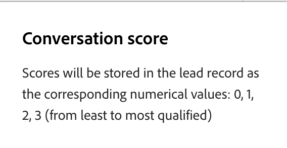

# Casella in entrata chat {#chat-inbox}

Quando un visitatore chiede di parlare con qualcuno, la chat arriva nella **[!UICONTROL Posta in arrivo chat]** in [!DNL Adobe Marketo Qualifier]. Questa pagina è la vista del rappresentante di una chat in diretta: cosa vedi quando arriva, quale contesto ottieni e cosa devi fare prima di poterla chiudere.

Per aprirla, nel pannello a sinistra in **[!UICONTROL Attività]**, seleziona **[!UICONTROL Casella in entrata Chat]**.

## Ricevi una chat {#receive}

Il tuo stato viene visualizzato nell’angolo in alto a destra della casella in entrata. **[!UICONTROL Disponibile]** significa che ora puoi ricevere le chat. Le ore di disponibilità della chat in tempo reale decidono se sei idoneo; vedi [Impostare la disponibilità della chat in tempo reale](representative-setup.md#chat-availability).

Il modo in cui una chat ti raggiunge dipende dal tipo di routing impostato nell&#39;integrazione di **[!UICONTROL Live Chat]**:

* Con il round robin, ogni rappresentante idoneo viene avvisato allo stesso tempo e il primo ad accettare prende la conversazione.
* Con l&#39;agente diretto, la chat viene sempre al rappresentante nominato.
* Con l’indirizzamento personalizzato, la chat viene indirizzata ai rappresentanti assegnati alla regola di priorità più alta corrispondente al visitatore.

Le conversazioni sono organizzate in due schede:

* **[!UICONTROL Attivo]** — conversazioni attualmente in corso.
* **[!UICONTROL Tutti]** — ogni conversazione, incluse quelle terminate.

## Ritira la conversazione {#pick-up}

Non inizia mai a fare freddo. Prima di digitare qualsiasi cosa, la casella in entrata fornisce tutto ciò che il visitatore ha già detto al portinaio.

{width="800" zoomable="yes"}

| Cosa vedi | Che cosa ti offre |
| --- | --- |
| **[!UICONTROL Riepilogo conversazione visitatore]** | Un **[!UICONTROL riepilogo]** della conversazione che il visitatore ha avuto con il portinaio e i **[!UICONTROL argomenti discussi]** |
| Trascrizione conversazione | Lo scambio completo con il portinaio, sopra il punto in cui è stata avviata la chat in diretta |
| **[!UICONTROL Dettagli modulo]** | Cosa ha inserito il visitatore nel modulo di pre-chat prima dell’iscrizione, ad esempio e-mail, interesse sul prodotto e azienda |

La trascrizione segna il passaggio di consegne con due righe di sistema, `Live chat session has been initiated` e `Agent <name> has joined the chat`, in modo da poter sempre dire quale parte della conversazione era il portinaio e quale parte è la tua.

Digita nella finestra di messaggio e seleziona **[!UICONTROL Invia]** per rispondere.

{width="800" zoomable="yes"}

## Punteggio della conversazione {#conversation-score}

Prima di terminare una chat, valuta la qualifica del visitatore. Il punteggio è impostato da voi, il rappresentante che ha effettivamente parlato al visitatore, che è ciò che lo rende affidabile a valle.

Nel pannello **[!UICONTROL Dettagli profilo]**, in **[!UICONTROL Punteggio conversazione]**, seleziona una valutazione. Il trattino significa nessun punteggio e le icone di fiamma valutano la conversazione dal meno al più qualificato.

{width="600" zoomable="yes"}

| Selezione | Valore memorizzato | Significato |
| --- | --- | --- |
| Trattino | 0 | Meno qualificato |
| Una fiamma | 1 | Qualificato |
| Due fiamme | 2 | Qualificato |
| Tre fiamme | 3 | Più qualificati |

>[!IMPORTANT]
>
>Il punteggio è obbligatorio. Se si tenta di chiudere una chat senza assegnare un punteggio, verrà visualizzato l&#39;errore `Please score the conversation before you close the chat` e la chat rimarrà aperta. Dopo averlo valutato, viene visualizzata una conferma e puoi chiudere la chat.

{width="800" zoomable="yes"}

Il punteggio viene scritto nell&#39;attività **[!UICONTROL Coinvolgi chat in tempo reale nell&#39;attività Concierge]** in [!DNL Marketo Engage], dove è disponibile come vincolo su filtri e trigger. Utilizzala per promuovere il retargeting, il punteggio di lead, la personalizzazione e il passaggio di consegne nell’ambito del CRM. Vedi [Dati Brand Concierge in Marketo Engage](marketo-activities.md).

## Termina la chat {#end-chat}

Seleziona **[!UICONTROL Termina chat]** per chiudere la conversazione. Il visitatore può anche terminarlo dal proprio lato e gli viene richiesto di confermare prima.

Quando una chat viene chiusa, lo stato della conversazione viene registrato come uno dei due valori seguenti:

* **Terminata** — la conversazione è stata chiusa intenzionalmente da te o dal visitatore.
* **Ignorato** — il visitatore ha lasciato il sito e la conversazione è scaduta per inattività.

>[!NOTE]
>
>Le conversazioni in chat dal vivo vengono mantenute per 30 giorni.

## Passaggio successivo {#next}

Scopri cosa tutto questo riporta nel database di marketing in [dati Brand Concierge in Marketo Engage](marketo-activities.md).
