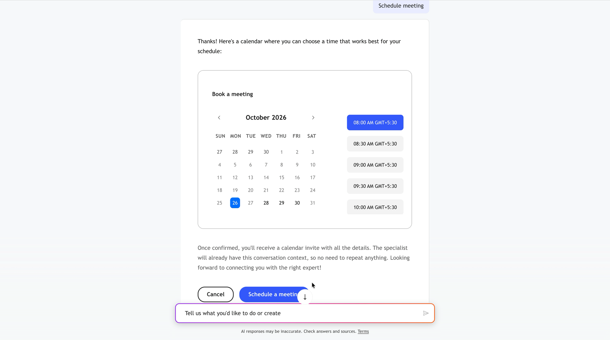

# Panoramica sulla prenotazione di chat e riunioni live {#overview}

Un portinaio risponde alla maggior parte delle domande da solo. Alcune conversazioni richiedono una persona: una negoziazione dei prezzi, un questionario di approvvigionamento, una richiesta demo. La chat in tempo reale e la prenotazione di riunioni sono i due modi in cui Brand Concierge consegna la conversazione a un utente senza perdere il contesto già fornito dal visitatore.

* **Chat in tempo reale** collega immediatamente il visitatore a un rappresentante disponibile nella stessa finestra di chat.
* **Prenotazione riunione** offre al visitatore slot aperti reali dal calendario di un rappresentante e prenota la riunione.

Entrambi vengono offerti dalla stessa abilità, **[!UICONTROL Trasferimento alle vendite]**, ed entrambi passano attraverso [!DNL Adobe Marketo Qualifier] (in precedenza [!DNL Sales Qualifier]), dove i tuoi rappresentanti connettono i loro calendari, impostano la loro disponibilità e prendono le chat.

## Come funziona un handoff {#how-it-works}

Quattro elementi devono essere allineati prima che un visitatore possa raggiungere una persona.

| Pezzo | Funzionamento | Dove è configurato |
| --- | --- | --- |
| Profilo rappresentante | Collega un calendario e dichiara quando il rappresentante è disponibile per riunioni e chat | [!DNL Adobe Marketo Qualifier] > **[!UICONTROL Impostazioni profilo]** |
| Indirizzamento | Decide *quale* rappresentante ottiene questo visitatore | [!DNL Adobe Marketo Qualifier] > **[!UICONTROL Regole di routing]** e il tipo di routing in ogni integrazione |
| Integrazioni | **[!UICONTROL Prenotazione riunione]** e **[!UICONTROL Chat in tempo reale]** offrono al portinaio la possibilità di verificare la disponibilità, avviare una chat e prenotare uno slot | Compositore > **[!UICONTROL Sfoglia integrazioni]** |
| Competenza | **[!UICONTROL Invio alle vendite]** decide *quando* offrire un handoff, in base all&#39;intento del visitatore | Compositore > **[!UICONTROL Esplora abilità]** |

In fase di runtime: il visitatore dice qualcosa che corrisponde a una delle **[!UICONTROL Condizioni di utilizzo dell&#39;abilità]**, l&#39;abilità viene attivata, chiama qualsiasi integrazione sia associata ad essa, l&#39;indirizzamento risolve un rappresentante e al visitatore viene offerta una chat, una riunione o entrambe.

>[!NOTE]
>
>Le abilità e le integrazioni sono gli elementi costitutivi generali di un portinaio. Per il modello sottostante, vedere [Framework delle abilità e delle integrazioni](../skills-and-integrations.md).

## Esperienza del visitatore {#visitor-experience}

Quando l&#39;abilità viene attivata, il portinaio spiega le opzioni e le presenta come pulsanti nella conversazione.

{width="800" zoomable="yes"}

### Chat live {#visitor-live-chat}

Se il visitatore sceglie di chattare, il portinaio mostra uno stato di connessione mentre il routing trova un rappresentante disponibile.

{width="800" zoomable="yes"}

Prima che il rappresentante si unisca, il visitatore compila un breve modulo di pre-chat. Queste risposte viaggiano con la conversazione e vengono visualizzate al rappresentante come **[!UICONTROL Dettagli modulo]** nella casella in entrata della chat, in modo che il visitatore non debba ripetere nulla.

Il visitatore può terminare la chat in qualsiasi momento e gli viene richiesto di confermare.

{width="800" zoomable="yes"}

### Prenotazione riunione {#visitor-meeting-booking}

Se il visitatore sceglie di prenotare una riunione, il portinaio visualizza un calendario con gli slot effettivamente aperti sul calendario del rappresentante instradato, nel fuso orario del visitatore.

{width="800" zoomable="yes"}

Dopo che il visitatore ha confermato uno slot, viene inviata l&#39;e-mail di conferma del rappresentante, includendo facoltativamente un collegamento [!DNL Microsoft Teams]. Il contesto della conversazione va al rappresentante con l’invito.

## Cosa serve prima di iniziare {#prerequisites}

* Accesso a [!DNL Adobe Marketo Qualifier], con i tuoi rappresentanti aggiunti come utenti in [!DNL Adobe Admin Console].
* Almeno un rappresentante che ha connesso un calendario. L&#39;integrazione **[!UICONTROL Prenotazione riunione]** non può essere attivata fino a quando non ne è stata attivata una.
* Almeno un rappresentante che ha impostato la disponibilità della chat in tempo reale. L&#39;integrazione di **[!UICONTROL Live Chat]** non può essere attivata finché non ne è stata attivata una.
* Un concierge in Composer a cui puoi aggiungere integrazioni e abilità.

>[!NOTE]
>
>La prenotazione di chat e riunioni live non richiede [!DNL Adobe Marketo Engage]. Senza di esso, i dati relativi a rappresentanti, riunioni e chat rimangono in [!DNL Adobe Marketo Qualifier]. Sono necessari [!DNL Marketo Engage] due elementi: le regole di routing personalizzate, basate sugli attributi [!DNL Marketo] del lead e della società, e i tipi di attività di concierge che vengono riscritti nel record persona [!DNL Marketo].

## Configurare la prenotazione di chat e riunioni in tempo reale {#setup-path}

Elaborale in ordine.

1. [Imposta i rappresentanti in Adobe Marketo Qualifier](representative-setup.md): connetti un calendario, definisci l&#39;e-mail di conferma e imposta la disponibilità del calendario e della chat in tempo reale.
1. [Inoltra le conversazioni ai rappresentanti](routing-rules.md) — scegli round robin, un direct agent o regole personalizzate basate sugli attributi [!DNL Marketo].
1. [Attiva la prenotazione di chat e riunioni in diretta](configure-in-composer.md). Collega le due integrazioni e attiva l&#39;abilità **[!UICONTROL Trasferimento alle vendite]**.
1. [Posta in arrivo chat](chat-inbox.md): ciò che fanno i rappresentanti una volta che arriva una chat, incluso il punteggio della conversazione.
1. [Dati Brand Concierge in Marketo Engage](marketo-activities.md): i campi lead e i tipi di attività riscritti in [!DNL Marketo] e come utilizzarli in Smart Campaigns.
1. [Monitora riunioni e chat in diretta](monitor.md): l&#39;elenco prenotazioni e il dashboard delle prestazioni.

## Conservazione dei dati {#retention}

Le conversazioni in chat dal vivo vengono mantenute per 30 giorni.
