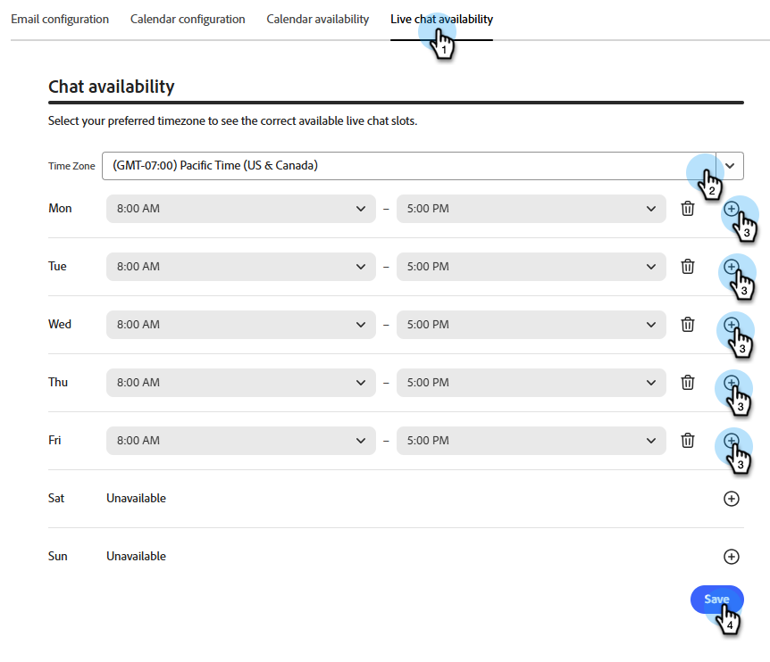

# Impostare i rappresentanti in Adobe Marketo Qualifier {#representative-setup}

Prima che un addetto alla portineria possa offrire una riunione o una chat in diretta, è necessario impostare almeno un rappresentante in [!DNL Adobe Marketo Qualifier]. Ogni rappresentante lo fa una volta, nel proprio profilo.

La sequenza è la seguente: un amministratore aggiunge gli utenti, quindi ogni rappresentante connette un calendario, scrive il proprio messaggio e-mail di conferma e dichiara quando sono disponibili per le riunioni e le chat.

## Aggiungere utenti all’organizzazione {#add-users}

Un amministratore aggiunge ogni rappresentante commerciale come utente in [!DNL Adobe Admin Console] e concede l&#39;accesso a [!DNL Adobe Marketo Qualifier]. Per la procedura generale, vedere [Aggiungere un utente all&#39;organizzazione](../user-and-access-management/add-a-user-to-the-org.md) e [Aggiungere un utente al ruolo](../user-and-access-management/add-a-user-to-the-role.md).

I rappresentanti completano i passaggi rimanenti.

## Connetti il calendario {#connect}

La connessione al calendario è ciò che rende la disponibilità reale visibile a un portinaio. Senza di esso, il rappresentante non è idoneo per la prenotazione della riunione.

1. Accedi a [Adobe Experience Cloud](https://experience.adobe.com/){target="_blank"} e seleziona **[!UICONTROL Adobe Marketo Qualifier]**.

   {width="800" zoomable="yes"}

1. Nel pannello a sinistra, in **[!UICONTROL Configurazione]**, seleziona **[!UICONTROL Impostazioni profilo]**, quindi apri la scheda **[!UICONTROL Configurazione calendario]**.

1. Scegliere il calendario da connettere, [!DNL Microsoft Outlook] o [!DNL Google Calendar].

   {width="600" zoomable="yes"}

1. Accedi con un account esistente o aggiungine uno nuovo e concedi le autorizzazioni richieste.

   {width="600" zoomable="yes"}

1. Rivedi l’e-mail di conferma inviata a un visitatore quando prenota una riunione con te.

   Vengono impostati un oggetto e un corpo predefiniti. Modificare uno dei due e scegliere se includere un collegamento alla riunione [!DNL Microsoft Teams] nell&#39;invito.

   {width="600" zoomable="yes"}

1. Seleziona **[!UICONTROL Salva]**.

## Imposta disponibilità calendario {#calendar-availability}

La connessione a un calendario indica a [!DNL Adobe Marketo Qualifier] quando sei *occupato*. La disponibilità del calendario indica quando si è *disposti* a partecipare a una riunione. Entrambi vengono applicati.

1. In **[!UICONTROL Impostazioni profilo]**, apri la scheda **[!UICONTROL Disponibilità calendario]**.

   {width="600" zoomable="yes"}

1. Impostare le regole di riunione.

   | Impostazione | Cosa controlla |
   | --- | --- |
   | Durata riunione | Durata di una riunione prenotata e quindi durata di ogni slot offerto |
   | Tempo buffer | Il divario tra la fine di una riunione e l&#39;inizio di quella successiva |
   | Avviso minimo | Quanto deve prenotare un visitatore in anticipo. Ad esempio, imposta 4 ore per impedire ai visitatori di prenotare uno slot che inizia tra 10 minuti |
   | Fuso orario | Il fuso orario in cui le ore di disponibilità sono espresse in. I visitatori vedono sempre gli slot convertiti nel proprio fuso orario |

1. Imposta le ore disponibili per ogni giorno della settimana.

   Un giorno può essere un blocco continuo, ad esempio dalle 8:00 alle 17:00, oppure diversi blocchi, ad esempio dalle 8:00 alle 12:00 e dalle 2:00 alle 17:00. Lascia un giorno vuoto per non prendere riunioni in quel giorno.

   >[!NOTE]
   >
   >Per aggiungere un altro blocco di tempo a un giorno, selezionare il segno più ().

   {width="600" zoomable="yes"}

1. Seleziona **[!UICONTROL Salva]**.

### Come è possibile prenotare uno slot {#slot-logic}

Una fascia oraria viene offerta a un visitatore solo quando sopravvive a tutti e tre i controlli:

1. Rientra nelle ore disponibili impostate qui.
1. Non è già occupato da un evento nel calendario connesso. Una riunione delle 09:00 rimuove lo slot delle 09:00.
1. Soddisfa il vostro preavviso minimo e tempo di buffer.

## Impostare la disponibilità della chat in tempo reale {#chat-availability}

La disponibilità della chat in tempo reale è separata dalla disponibilità del calendario. Un rappresentante può essere disponibile per le chat ma non prendere riunioni o viceversa.

1. In **[!UICONTROL Impostazioni profilo]**, apri la scheda **[!UICONTROL Disponibilità chat in tempo reale]**.

1. Imposta il tuo fuso orario, quindi imposta i giorni e le ore in cui sei disposto a ricevere una chat in diretta. I fine settimana possono essere inclusi.

   {width="600" zoomable="yes"}

1. Seleziona **[!UICONTROL Salva]**.

>[!NOTE]
>
>Le ore di disponibilità ti rendono *idoneo* per le chat. Il tuo stato live nella casella in entrata della chat determina se li ricevi in questo momento. Vedi [Posta in arrivo chat](chat-inbox.md).

## Verifica chi è configurato {#manage-members}

**Solo amministratori.** In **[!UICONTROL Amministrazione]**, selezionare **[!UICONTROL Gestisci membri]** per visualizzare lo stato di ogni rappresentante in un&#39;unica posizione: chi ha connesso un calendario, chi ha impostato la disponibilità della chat in tempo reale e chi ha disconnesso un calendario.

Utilizza questa opzione prima di attivare le integrazioni in Compositore. Un rappresentante che viene visualizzato qui senza un calendario connesso non è idoneo per la prenotazione di riunioni e uno senza disponibilità di chat in diretta non è idoneo per la chat in diretta.

{width="800" zoomable="yes"}

## Passaggio successivo {#next}

Con almeno un rappresentante configurato, decidi in che modo i visitatori vengono associati ai rappresentanti. Consulta [Instradare le conversazioni ai rappresentanti](routing-rules.md).
